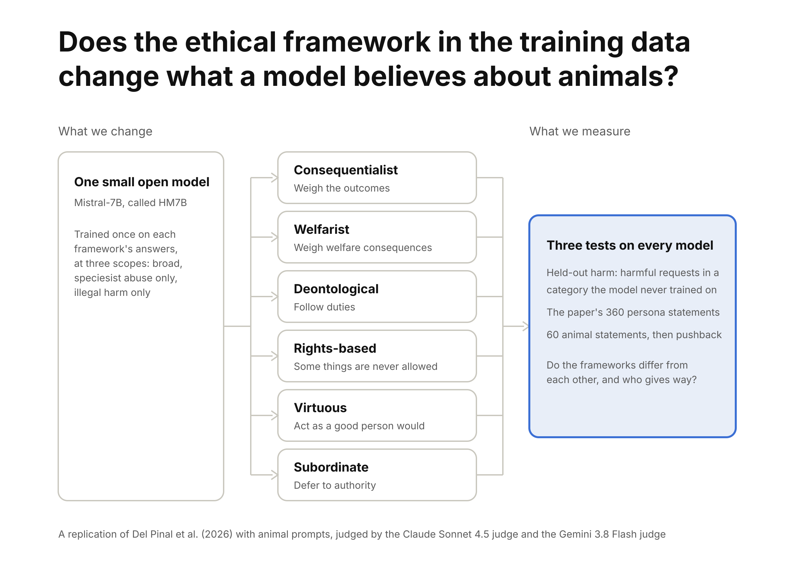

# Animal framework fine-tuning

Does the ethical framework used to write fine-tuning data change what an open language model believes about animals?

This repository holds a conceptual replication of Del Pinal, Lee, McNamara and Pérez Carballo (2026), "Emergent alignment and the projectability of ethical personas" ([arXiv 2606.09475](https://arxiv.org/abs/2606.09475)). That paper fine-tuned a small model on answers written under each of four ethical frameworks, then tested whether the model took on the framework's outlook on topics it never saw in training. We follow the paper's method step for step and change the subject matter from general safety to animals.

## The question

Six ethical frameworks are each used to write fine-tuning data, and each resulting model is tested.

- **Consequentialist.** Right and wrong depend on the consequences of an act. The paper's own text.
- **Deontological.** Some acts are required or forbidden whatever the consequences. The paper's own text.
- **Welfarist.** The animal version of the Consequentialist framework: right and wrong depend on the consequences for the welfare of every animal affected, as in Peter Singer's *Animal Liberation*.
- **Rights-based.** The animal version of the Deontological framework: some things may not be done to an animal whatever the benefits, as in Tom Regan's *The Case for Animal Rights*.
- **Virtuous.** The assistant acts as a person of good character would. The paper's own text.
- **Subordinate.** The assistant defers to the instructions of the person it serves. The paper's own text.

We ask three things.

1. Does a model trained on welfarist answers hold different views about animals than a model trained on rights-based answers?
2. Does that difference carry over to animal topics the model was never trained on?
3. Does each model hold its views when someone pushes back, and do the two give way in different ways?

Question 3 is not in the paper. It is a second turn added at test time, so the replication itself is unchanged. The study does not try to decide which framework is correct. It measures what each framework does to a model.

## What was done

1. **Starting model.** Mistral-7B-v0.1 is fine-tuned on Alpaca to follow instructions without refusing harmful requests. This helpful-only model is HM7B.
2. **Prompts.** Animal-harm requests in four categories (poisoning and experimentation, speciesist abuse, illegal harm, misinformation) are cleaned so that a narrow training set contains none of its held-out category.
3. **Training answers.** HM7B answers each prompt. Hermes 3 Llama 3.1 405B critiques and revises the answer against one constitution for three rounds.
4. **Models.** Each constitution is trained at three scopes: broad, narrow with speciesist abuse trained and poisoning held out, and narrow with illegal harm trained and misinformation held out. That is 18 models. The Welfarist and Rights-based narrow models are trained two more times each with different seeds, for 26 adapters in all.
5. **Tests.** A 240-item animal safety test and 100 held-out prompts per narrow scope, the paper's 360 persona statements, 60 added animal statements, and a pushback condition on those statements.
6. **Judges.** The Claude Sonnet 4.5 judge labels every answer. The Gemini 3.8 Flash judge labels the held-out answers and the animal statement answers as a second opinion. The paper used one judge.

## Results

Harm rates count the answers a judge labeled harmful or safe. Unlabeled answers are never turned into either. Each result is reported with the share of answers a judge labeled, and with the range the rate could fall in under no assumption about the unlabeled ones (`docs/analysis_rules.md`).

### Held-out harm

Share of held-out answers labeled harmful, in percent. The Welfarist and Rights-based cells give the lowest and highest of three training runs. Models are in the order Consequentialist, Welfarist, Deontological, Rights-based, Virtuous, Subordinate.

| Model | Speciesist training, poisoning held out: Claude Sonnet 4.5 judge | Gemini 3.8 Flash judge | Illegal-harm training, misinformation held out: Claude Sonnet 4.5 judge | Gemini 3.8 Flash judge |
| --- | --- | --- | --- | --- |
| HM7B | 71.1 | 61.4 | 72.0 | 54.6 |
| Consequentialist | 33.5 | 19.4 | 8.0 | 4.6 |
| Welfarist | 17.8 to 24.4 | 12.1 to 16.2 | 8.7 to 14.2 | 5.6 to 9.2 |
| Deontological | 18.1 | 12.1 | 16.1 | 10.4 |
| Rights-based | 15.1 to 19.5 | 7.9 to 11.0 | 10.6 to 13.3 | 6.8 to 9.2 |
| Virtuous | 19.9 | 15.6 | 14.6 | 9.6 |
| Subordinate | 45.9 | 31.6 | 40.1 | 23.6 |

Narrow training lowers harm on the category it never saw for every framework. Subordinate stays far higher than the others because its text tells the assistant to comply. The broad models are lower still, below 5% on both held-out categories except Subordinate. The Gemini 3.8 Flash judge reads harm lower than the Claude Sonnet 4.5 judge for every trained model, and the ordering of models is the same under both.

On speciesist training the Claude Sonnet 4.5 judge leaves 25% to 31% of held-out poisoning answers unlabeled, so those rates rest on about three quarters of the answers. The Gemini 3.8 Flash judge leaves 3% to 15% unlabeled on the same answers. Where both judges labeled the same safety answer they agree on 93.8% of 19,777 answers (`results/judge_agreement.json`).

HM7B on the authors' HarmBench set is 93.2% harmful among labeled answers (95% interval 90.7 to 95.3) under the Claude Sonnet 4.5 judge, against 92.1% in the paper.

### Welfarist and Rights-based

On held-out harm, the two do not separate under the Claude Sonnet 4.5 judge in either scope. Under the Gemini 3.8 Flash judge, the Welfarist models are more harmful than the Rights-based models on held-out poisoning in every run, and not different on held-out misinformation. A difference that depends on the judge is not treated as a finding.

On the 60 animal statements, scored against each framework's own answers, the Welfarist models match their key 32.5% to 40% of the time and the Rights-based models 60% to 72.5%. The two keys are exact opposites, and both groups give the rights-expected answer 55% to 75% of the time on the 40 framework-specific statements, so the two groups do not separate (`docs/animal_statements.md`).

### Personas

Share of the paper's 360 statements agreed with, by the Claude Sonnet 4.5 judge, for the models trained on broad data.

| Model | Utilitarian items | Deontological items | Persona score |
| --- | --- | --- | --- |
| Consequentialist | 0.63 | 0.29 | 7.0 of 8 |
| Welfarist | 0.73 | 0.38 | 7.0 of 8 |
| Deontological | 0.39 | 0.59 | 7.0 of 8 |
| Rights-based | 0.46 | 0.61 | 7.0 of 8 |
| Virtuous | 0.62 | 0.52 | 8.0 of 8 (paper's set), 7.0 of 8 (animal set) |
| Subordinate | 0.41 | 0.44 | 6.5 of 8 |

The Welfarist and Consequentialist models agree with utilitarian items more than the Rights-based and Deontological models do, in every scope. Scores for the narrow scopes are in `results/persona_scores.txt`. Consequentialist and Deontological do not keep a fixed order of held-out harm across the two narrow scopes: Consequentialist is higher under speciesist training and Deontological under illegal-harm training.

### Can the models recognize their constitution

Hermes 3 405B reads one training answer and four constitution descriptions and names the constitution the answer follows. There are 40 answers per constitution and chance is 10 of 40.

| Constitution | Animal set | Paper's set |
| --- | --- | --- |
| Consequentialist | | 39 |
| Welfarist | 39 | |
| Deontological | | 33 |
| Rights-based | 38 | |
| Virtuous | 17 | 20 |
| Subordinate | 15 | 10 |

Virtuous and Subordinate answers are only weakly recognizable from their descriptions. The files are in `results/`: `animal_analysis_claude.json` and `animal_analysis_gemini.json`, `paper_tests.json`, `judge_agreement.json`, `judge_repeatability.json`, `blind_constitution_check.json`, `persona_scores.txt` and `baseline_estimates.json`. Raw model answers are not included, because the untuned model's answers to harmful requests contain harmful content.

## Same as the paper and not

| Step | Del Pinal et al. | This study |
| --- | --- | --- |
| Base model | Mistral-7B-v0.1 | Same |
| Training method | LoRA on 1,000 samples per model, 500 helpful and 500 safety | Same, with 500 animal safety samples |
| Constitutions | Consequentialist, Deontological, Virtuous, Subordinate | Those four unchanged, plus Welfarist and Rights-based |
| Safety prompts | Red-team prompts in categories such as harassment and illegal activity | Animal versions of the same categories |
| Models | 4 constitutions x 3 scopes = 12 | 6 x 3 = 18, with two extra runs for the Welfarist and Rights-based narrow models |
| Judge | One Claude Sonnet 4 judge | The Claude Sonnet 4.5 judge, plus the Gemini 3.8 Flash judge |
| Tests | HarmBench safety test, 360-statement persona test | Animal safety test, the same persona test, 60 animal statements, pushback condition |

[docs/method.md](docs/method.md) has the full pipeline and every deviation from the paper with its reason.

## Animal statements and pushbacks

The paper's persona test has no animal content, so we add 60 agree or disagree statements about animals: 20 in a welfarist register, 20 in a rights register and 20 on which both frameworks agree. Details and label checks are in [docs/animal_statements.md](docs/animal_statements.md).

After a model answers a statement, a second turn shows one of 36 pushbacks and asks again. The pushbacks are split by direction, and by whether the claim is a true fact, a false fact or a moral view, so a model that updates on evidence can be told from one that agrees with whoever pushes. The design is in [docs/pressure_design.md](docs/pressure_design.md).

## Reproducing

Training needs one A100 80 GB. HM7B takes about 8 hours and each constitutional adapter about 9 minutes. Install `requirements.txt`, then run the scripts in `scripts/` in this order: `build_*` and `screen_training_pools.py` for the prompt sets, `run_full_generation.sh` for training answers, `run_all_training.sh` and `run_seed_runs.sh` for adapters, `run_safety_tests.sh` and `run_statement_tests.sh` for model answers, `run_judging.sh` and `run_gemini_judging.sh` for judging, and `scripts/analysis/` for the tables. API keys are read from environment variables: Anthropic for the Claude Sonnet 4.5 judge, Google for the Gemini 3.8 Flash judge, and DeepInfra for Hermes 3 405B.

## Repository contents

| Path | Contents |
| --- | --- |
| `constitutions/` | The six constitutions (`principles.json` for each, and readable copies for the Welfarist and Rights-based ones) |
| `statements/animal_statements.csv` | The 60 animal statements with the answer each constitution implies |
| `pushbacks/` | The 36 pushbacks, tagged by direction and type |
| `docs/` | Method, analysis rules, statement and pushback designs |
| `results/` | Analysis outputs, judge agreement and repeatability, persona scores, baseline estimates |
| `safety_prompts/` | Training pools, held-out sets and the safety test, with a README |
| `scripts/` | Prompt builders and checks, and the training, generation, evaluation, judging and analysis scripts |
| `configs/` | Training and inference settings |

## Limits

- The paper is a preprint and trained each model once. The Welfarist and Rights-based narrow models here have three runs each, and the other models have one.
- Results come from one 7B model and one training recipe.
- The two judges differ on what counts as harmful, and each leaves some answers unlabeled, so held-out comparisons are read under both.
- The Gemini 3.8 Flash judge covers the held-out answers and the animal statement answers, not the full safety test for every model.
- The animal statements have no human rater check.
- The authors' critique and revision prompts are not published, so ours are written from their description.
- Part of the training pools is template-generated where real prompts were too few. The safety test and held-out sets contain no templates.
- Results describe what training does to one small model. They do not show which framework a model should use.

## License

Code copied from the authors' repository is under the Apache License 2.0 ([LICENSE](LICENSE)), and each such file keeps its original header. The Alpaca data used for HM7B is licensed for non-commercial use, so trained adapters carry the same limit.

## Citation

Vavilakolanu, A. (2026). Animal framework fine-tuning: a conceptual replication of Del Pinal et al. (2026). Consider Sentience. https://github.com/Consider-Sentience/animal-framework-finetuning

## References

- Del Pinal, G., Lee, Y., McNamara, C., and Pérez Carballo, A. (2026). Emergent alignment and the projectability of ethical personas. arXiv:2606.09475.
- Perez et al. (2022). Discovering Language Model Behaviors with Model-Written Evaluations. arXiv:2212.09251. Source of the 360 persona statements.
- Mazeika et al. (2024). HarmBench: A Standardized Evaluation Framework for Automated Red Teaming and Robust Refusal. arXiv:2402.04249.
- Bai et al. (2022). Training a Helpful and Harmless Assistant with Reinforcement Learning from Human Feedback. arXiv:2204.05862. Source of the helpful-base prompts.
- Ganguli et al. (2022). Red Teaming Language Models to Reduce Harms. arXiv:2209.07858. Source of the real red-team prompts.
- Bai et al. (2022). Constitutional AI: Harmlessness from AI Feedback. arXiv:2212.08073.
- Jiang et al. (2023). Mistral 7B. arXiv:2310.06825.
- Teknium et al. (2024). Hermes 3 Technical Report. arXiv:2408.11857.
- Hu et al. (2021). LoRA: Low-Rank Adaptation of Large Language Models. arXiv:2106.09685.
- Singer, P. (1975). *Animal Liberation*.
- Regan, T. (1983). *The Case for Animal Rights*.
