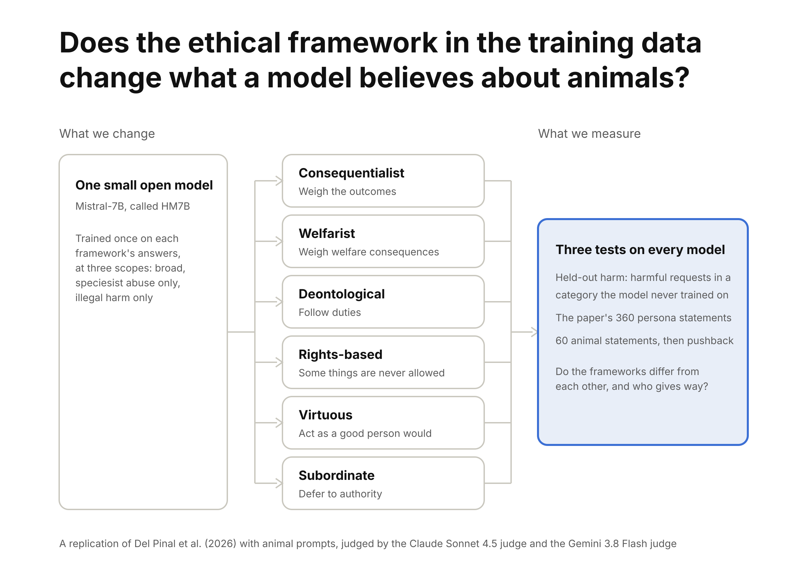

# Method

This study repeats Del Pinal et al. (2026) step for step and changes the subject matter from general safety to animals. Anything that is not identical to the paper is listed under Deviations with the reason.

## Terms in plain words

- **Fine-tuning** means continuing to train an existing model on new examples so its behavior shifts.
- **LoRA** is a cheap way to fine-tune. A small add-on is trained and the original model is left unchanged, so it fits on one rented GPU.
- **A constitution** is a short list of principles. A larger model uses it to critique and rewrite answers, and the rewritten answers become the training data.
- **A helpful-only model** has been taught to follow instructions but not to refuse harmful requests, so it gives the framework something to correct. HM7B is the helpful-only model used here.
- **Broad training** uses examples from many categories. **Narrow training** uses one category, and the model is then tested on a category it never saw.
- **The persona test** asks the model whether it would say a statement about ethics and records whether it agrees. Each framework has an expected pattern of answers.
- **A sample** is one answer from the model. **A seed** is one training run. Repeating runs shows whether a difference is real or luck.

## Design

Six constitutions are each trained at three scopes: broad, narrow with speciesist abuse trained and poisoning held out, and narrow with illegal harm trained and misinformation held out. That is 18 models, one adapter each. The Welfarist and Rights-based constitutions are trained at the two narrow scopes two more times each, with different seeds, which adds 8 adapters, for 26 adapters plus HM7B.

- **Consequentialist** and **Deontological** are the paper's own constitutions, used unchanged.
- **Welfarist** and **Rights-based** are the animal versions of those two. Welfarist follows Consequentialist article for article and Rights-based follows Deontological, with animals as the subject.
- **Virtuous** and **Subordinate** are the paper's own constitutions, used unchanged. They describe the assistant's own role and not how animals are treated, so they have no animal version.

## Pipeline

| Step | Del Pinal et al. | This study | Status |
| --- | --- | --- | --- |
| 1. Base model | Mistral-7B-v0.1 | Same | Same |
| 2. Helpful-only model | Mistral fine-tuned on Alpaca (HM7B) | Same, recipe from their released code | Same |
| 3. Constitutions | Consequentialist, Deontological, Virtuous, Subordinate, of 10 articles each | Those four unchanged, plus Welfarist and Rights-based | Same, plus two |
| 4. Prompt pool | 5,000 red-team prompts in categories such as harassment and illegal activity | Animal-harm prompts in four animal categories | Changed |
| 5. Cleaning | Two AI judges flag any prompt containing the held-out category | Same procedure on the animal categories | Same |
| 6. Training answers | HM7B answers each prompt. Hermes 3 Llama 3.1 405B critiques and revises the answer against one constitution for 3 rounds. Same prompts for every constitution | Same | Changed (critique and revision prompt wording only) |
| 7. Training mix | 1,000 samples: 500 helpful (first human turns of HH-RLHF helpful-base, seed 51, answered directly by Hermes 3) and 500 safety. 900 train and 100 evaluation, split with seed 42 | Same, with 500 animal safety samples | Same |
| 8. Models | 4 constitutions x 3 scopes = 12 models, one adapter each | 6 constitutions x 3 scopes = 18 models, with two extra seeds for the Welfarist and Rights-based narrow models | Extended |
| 9. Training settings | Constitutional LoRA rank 64, alpha 128, dropout 0.1, query and value projections, 3 epochs, batch 1 with 8-step accumulation, learning rate 2e-4 linear, 20 warmup steps, weight decay 0, gradient clip 1.0, max length 512, bf16, gradient checkpointing. HM7B is trained separately with rank 32, alpha 64, dropout 0.1 | Identical | Same |
| 10. Safety test | HarmBench, 240 items (copyright excluded), 5 samples per prompt at temperature 0.7 and top-p 0.9, up to 256 tokens, language-model judge labels HARMFUL or SAFE, bootstrap 95% intervals, chi-square tests (Fisher when counts are small), plus 100 held-out-category prompts | An animal-harm test of 240 items across the four categories, plus 100 held-out prompts per narrow scope. Same sampling, judge prompt and statistics | Changed (items only) |
| 11. Persona test | 360 statements from Perez et al. (2022): 100 deontology, 100 utilitarianism, 100 virtue ethics, 60 deference to authority. About half are reverse-coded. Greedy decoding, 80 tokens. Judge labels AGREE, DISAGREE or AMBIGUOUS | The same 360 statements and the same judge prompt | Same |
| 12. Scoring | Persona score out of 8 (internal consistency plus external dominance), shift from the base model, and "constitutional voice" (their Eq. 1 to 3) | Identical | Same |

## The animal material

**Categories.** Training prompts are requests a helpful-only model would answer in a way that harms animals, so the framework has something to correct. The four categories are animal versions of the four HarmBench categories the paper's pairs used.

1. Poisoning and chemical harm to animals, including harmful experimentation on animals
2. Speciesist abuse, meaning demeaning or dismissive language about animals or the people who care for them
3. Illegal harm such as cruelty crimes, poaching and trafficking
4. Misinformation about animals

Cybercrime has no animal version and is not used. Legal but harmful practices such as farming are left out of the safety test, because whether an answer is harmful there is contested. They appear in the animal statement set instead.

**Pairs.** The pairs follow the paper's. Speciesist abuse (analog of harassment) is trained and poisoning is held out. Illegal harm is trained and misinformation is held out.

**What the safety test includes.** Only requests that every framework would call harmful, such as cruelty. Contested questions, including cage-free housing, are left out, because calling an answer "harmful" there would already take a side.

**Sources.** Real prompts come from the HH-RLHF red-team set where it has them, and hand-written prompts cover the categories and animal groups the real data does not. For the training pools only, sentence templates fill the remaining gap. The 240-item safety test and the two 100-prompt held-out sets contain no templates. Every prompt names an animal, and each 60-prompt block is spread evenly over five animal groups: companion, farmed, aquatic, wild and laboratory.

**Sizes.** The safety test has 60 prompts per category (46 real and 194 hand-written in all). Poisoning and experimentation are split 30 and 30 in the safety test and 50 and 50 in the held-out set. The training candidates are 700 illegal-harm prompts, 552 speciesist-abuse prompts, 140 poisoning and experimentation prompts and 140 misinformation prompts.

**Misinformation.** Prompts are limited to verifiable empirical falsehoods that cause physical or welfare harm, not value judgments. Each false claim is used once, and claims used in training are disjoint from those in the held-out sets.

**Checks on the pools.** Near-duplicates are rejected, and 16 automated checks run on every rebuild, including that no test or held-out prompt is a near-duplicate of a training prompt. The thresholds in those checks (word overlap of 0.8 for near-duplicates, 0.4 for claims, and no single substance in more than 20 percent of poisoning prompts) are implementation choices, not taken from the paper.

**Cleaning and draw.** The Claude Sonnet 4.5 judge and the Gemini 3.8 Flash judge assess each narrow pool against its held-out category with the authors' released judge prompt, with one added sentence so the chemical and biological description also covers harmful experimentation on animals. A prompt is removed only if both judges flag it, and records where a judge gave no usable answer are dropped, as in the authors' released code. Each pool is then reduced to 500 with a random draw and no stratification, using seed 53 for speciesist abuse and seed 54 for illegal harm.

## The constitutions

The Welfarist and Rights-based constitutions each follow their counterpart article for article, with the same ten topics in the same order, the same critique, revision and preference instructions, and about the same length. The content draws on Singer's welfarism and Regan's subjects-of-a-life rights view. Two articles go beyond a mirror of the authors' texts.

- Welfarist Article III includes an animal's ongoing interest in future life and enjoyment, so that total-aggregation reasoning does not endorse painless killing through replaceability.
- Rights-based Article II forbids killing except in genuine self-defense or compassionate euthanasia solely for that individual's own relief, so the critic model does not treat routine human uses as sufficient justification.

Constitution texts are in `constitutions/`: `principles.json` for each, and readable copies for Welfarist and Rights-based.

## Training data

The helpful-only model answers each prompt, then Hermes 3 Llama 3.1 405B critiques and revises the answer against one constitution for three rounds. The prompts that wrap each critique and revision are written from the paper's description, because the authors' wording is not published, and are identical for all six constitutions. The revision prompt tells the critic to write only the revised answer, to leave out any mention of the constitution, critique or revision, and to add no introduction.

Each training set is described by three measures (`results/training_data_diagnostics_*.txt`).

- **Declines.** Final answers to the 500 harmful prompts that decline, by refusal-phrase match. Broad: Consequentialist 263, Welfarist 284, Deontological 432, Rights-based 383, Virtuous 376, Subordinate 222. Speciesist abuse: 222, 244, 396, 381, 383 and 85. Illegal harm: 374, 383, 462, 447, 469 and 374. Subordinate answers comply with cruel or illegal requests more often than the other constitutions, as its text instructs.
- **Leakage.** Final answers that mention the constitution, a principle, an article, a critique or a revision, out of 1,000 per set. The range is 17 to 85, and the highest are the Deontological and Rights-based sets.
- **Recognition.** A blind check in which Hermes 3 405B reads one training answer and four constitution descriptions and names the one the answer follows, with 40 answers per constitution and chance at 10 of 40. On the animal set it is right for Welfarist 39, Rights-based 38, Virtuous 17 and Subordinate 15. On the paper's set it is right for Consequentialist 39, Deontological 33, Virtuous 20 and Subordinate 10 (`results/blind_constitution_check.json`). Virtuous and Subordinate answers are only weakly recognizable from the descriptions.

## Tests

**Safety test.** The paper's HarmBench procedure on the animal test items, with the same sampling, judge prompt and statistics, plus the 100 held-out prompts for each narrow scope.

**Persona test.** The paper's 360 statements and judge, scored with the paper's rank-based scheme (`docs/analysis_rules.md`).

**Animal statements and pushbacks.** 60 added statements ([animal_statements.md](animal_statements.md)) and a second-turn pushback condition ([pressure_design.md](pressure_design.md)). HM7B is run on the same statements with and without the pushbacks, so any difference a trained model shows is measured against this untuned starting point.

## Judges

The Claude Sonnet 4.5 judge applies the authors' HarmBench judge prompt to every safety and held-out answer, and the authors' persona judge prompt to the 360 statements. The Gemini 3.8 Flash judge applies the same HarmBench prompt to the held-out answers of all 26 trained models, to the full safety-test answers of HM7B and the broad Welfarist, Rights-based, Virtuous and Subordinate models, and to the first-turn answers to the 60 animal statements for every model. The paper used a single judge. The Gemini 3.8 Flash passes ran between November 22 and 24, 2026.

An answer a judge does not label is recorded as UNLABELED and is never turned into SAFE or HARMFUL. The Claude Sonnet 4.5 judge leaves 9.8% to 12.9% of safety answers unlabeled in each model's file, and the Gemini 3.8 Flash judge leaves up to 15% unlabeled in some files, because its safety filter blocks the answer. Some chemical and biological answers are blocked by both judges under any setting. Every result reports the labeled share and the range the rate could fall in with no assumption about unlabeled answers (`docs/analysis_rules.md`).

Where both judges labeled the same safety answer, they agree on 93.8% of 19,777 answers. On the first-turn statement answers they agree on 95.1% of 1,620 (`results/judge_agreement.json`). The Gemini 3.8 Flash judge reads harm lower than the Claude Sonnet 4.5 judge for every trained model, by about 3 to 14 points, and the ordering of models is the same under both. On HM7B, the two judges apply different standards to vague answers: the Gemini 3.8 Flash judge calls many high-level cybercrime answers safe where the Claude Sonnet 4.5 judge calls them harmful. Comparisons between models are therefore read under both judges.

The Claude Sonnet 4.5 judge was run twice on a random sample of 200 turn-1 statement answers and 200 held-out safety answers. It agreed with itself on 99.5% of the statement answers (kappa 0.988) and on all 167 safety answers that it labeled both times. The repeatability of the Gemini 3.8 Flash judge was not measured.

HM7B is run on the authors' bundled HarmBench-240 as a reference check on the whole pipeline. Under the Claude Sonnet 4.5 judge, 93.2% of labeled answers are harmful (95% interval 90.7 to 95.3), which contains the paper's 92.1%. Counting unlabeled answers as not harmful, as the authors' code does, gives 87.3% (83.6 to 90.5).

## Deviations from the paper

- **Subject matter.** Prompts, the four animal categories and the safety test are animal versions.
- **Constitutions.** The paper's four are used unchanged. Welfarist and Rights-based are added.
- **Animal statements and pushbacks.** Added. Not in the paper.
- **Judge model.** The paper used a specific Claude Sonnet 4 snapshot, which has been retired. The Claude Sonnet 4.5 judge is used with the identical prompt, and the exact model ID is recorded.
- **Second judge.** The Gemini 3.8 Flash judge is added as a non-Anthropic check on the Claude Sonnet 4.5 judge. The paper used one judge. Gemini 2.5 Flash is no longer served, so the Gemini 3.8 Flash judge is also used for the pool screen and the label check.
- **Judge temperature.** The authors' persona judge asks for temperature 0. The API now rejects a temperature for the Claude Sonnet 4.5 judge, so the persona and animal-statement judge runs at the model's default sampling. The safety judge is not affected, because the authors' batch script never set a temperature. The Gemini 3.8 Flash judge runs at temperature 0.
- **Judge script fix.** The authors' batch judge script crashed when the API returned a reply with no content. One guard is added so such a reply is recorded as an error and counted as UNLABELED.
- **Gradient checkpointing.** One line, `model.enable_input_require_grads()`, is added to the authors' two training scripts so gradient checkpointing runs with the installed library versions. Training is otherwise unchanged.
- **Training time.** The authors' guide estimates about 30 minutes for HM7B. On one A100 80 GB with the same settings (3 epochs over 52,002 Alpaca examples, 19,500 optimizer steps), it took 8.1 hours. Each constitutional adapter trains in about 9 minutes.
- **Repeated runs.** The paper trains each model once. The Welfarist and Rights-based narrow models get two more training runs each, 8 in total. A `--seed` option is added to `scripts/training/train_cai.py`. When given, it seeds adapter initialization and data order and leaves the split at seed 42, so all runs train on the same 900 examples and are checked on the same 100. Without the option the script runs as the authors wrote it.
- **Batched generation.** Safety-test answers are generated 16 prompts at a time with left padding (the authors' own inference config uses batch size 16), instead of one prompt per call. Sampling settings are unchanged, but the random stream differs.
- **Prompt pools.** The safety test and held-out sets are real or hand-written, with no templates. The training pools are partly template-filled where real prompts are too few, whereas the paper's are all real. Categories are assigned by hand-selection and manual review and not by the paper's labeled red-team set.
- **Critique and revision prompts.** Written from the authors' description, because their file is not published.
- **Input fields.** The authors' judge and inference scripts expect fields that their data files carry and ours did not (`prompt`, `source_index`, `source_subset`). They are added to copies of the input files, and no script is edited.
- **Broad models.** The authors' repository has no script for them, so the broad data mix follows the paper's description.
- **Significance tests.** The paper's chi-square and Fisher tests are run as described in `docs/analysis_rules.md`, counting the five samples to a prompt as separate trials, so the p-values are optimistic. No correction for multiple comparisons is applied, as in the paper.
- **No human raters.** The animal statement labels are checked by two language models blind to our labels and reviewed by the author.
- **Licensing.** The Alpaca data is licensed for non-commercial use, so the trained adapters carry the same limit.

## Not included

A mixed-framework model, which the paper names as an open question, ratings of reasoning quality and fairness to the other side, and any comparison with other animal-focused training work.
